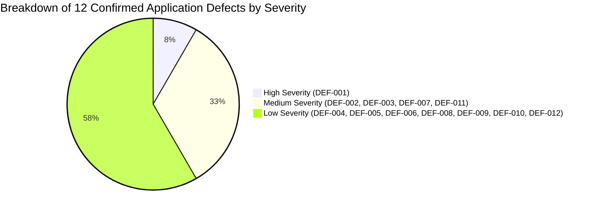
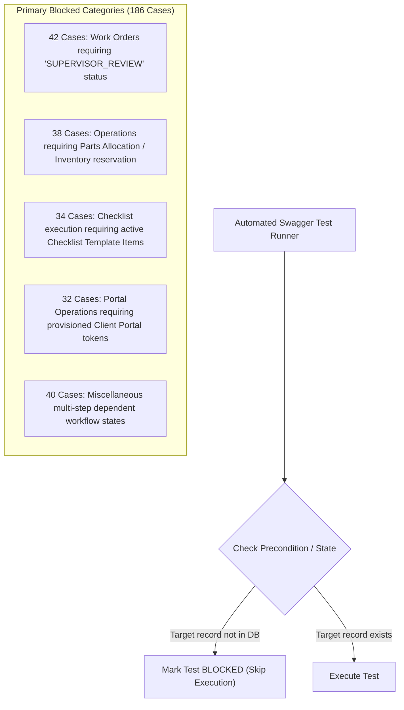
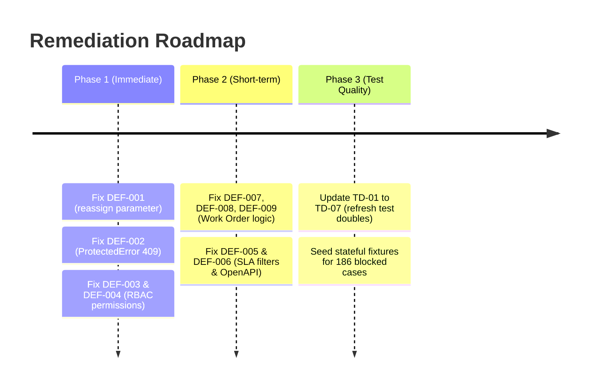

# FieldOps Nexus – Unit & API Testing Root Cause Analysis (RCA) Report

**Source Document:** `FieldOps_Nexus_C_LH_Unit_Testing_Report (1).xlsx`  
**Target Repository:** FieldOps Nexus  
**Prepared Test Cases:** 3,921  
**Executed Test Cases:** 3,735  
**Pass Rate (of Executed):** 98.29% (3,671 Passed)  
**Total Failures:** 64 (1.71%)  
**Total Blocked:** 186  

---

## 1. Executive Summary & Test Metrics

The unit test run executed **3,735 out of 3,921 prepared test cases** (95.26% execution rate), achieving an overall pass rate of **98.29%** on executed tests.

| Status | Count | Percentage of Executed | Description |
| :--- | :---: | :---: | :--- |
| **Passed** | **3,671** | **98.29%** | Passed all assertion criteria. |
| **Failed** | **64** | **1.71%** | Assertion mismatches, unhandled exceptions, or HTTP status anomalies. |
| **Blocked** | **186** | *N/A (unexecuted)* | Prerequisite state/seed records not present in the automated fixture. |
| **Total Executed** | **3,735** | **100.00%** | Mock unit tests (1,371) + Swagger-driven API tests (2,364). |
| **Total Prepared** | **3,921** | — | Total test suite surface area. |

### Failure Categorization: Why Did the 64 Tests Fail?

The **64 failures** fall into two distinct engineering categories:

1. **Confirmed Application Defects (16 Failed Tests across 12 Defect IDs):**  
   True bugs, service signature mismatches, unhandled database exceptions, and validation gaps in the Django backend.
2. **Stale Test Doubles / Mock Drift (48 Failed Tests across 7 Test-Debt IDs):**  
   Unit tests authored against early schema prototypes that failed because their mock objects (`SimpleNamespace` / `MagicMock`) lacked attributes or signatures introduced in subsequent backend updates.

---

## 2. In-Depth Root Cause Analysis: Confirmed Application Defects (DEF-001 – DEF-012)



---

### DEF-001: Work Order Reassignment Signature Mismatch (HTTP 500)
- **Severity:** High
- **Module:** M06 – Work Order Management
- **Affected Tests:** `WO-A-123`, `WO-A-270`
- **Endpoint:** `POST /api/v1/work-orders/{id}/reassign/`

#### Failure Mechanism
When calling the reassign endpoint, the Django view crashes with:
```text
TypeError: reassign_work_order() got an unexpected keyword argument 'technician'
HTTP Response: 500 Internal Server Error
```

#### Underlying Root Cause
The API view extracted the assignee payload and invoked `services.reassign_work_order(..., technician=user)`, but the underlying domain service signature in `src/apps/work_orders/services.py` was updated to expect `assignee` (or `membership`). Because of this naming divergence between the view and domain service, Python raises an unhandled `TypeError` bubbling up as an HTTP 500 crash.

#### Remediation
Align the parameter call site in `WorkOrderViewSet.reassign()` to pass `assignee=technician_user`.

---

### DEF-002: Role Deletion Triggers Unhandled `ProtectedError` (HTTP 500)
- **Severity:** Medium
- **Module:** Security & RBAC
- **Affected Tests:** `RBAC-A-019`
- **Endpoint:** `DELETE /api/v1/roles/{id}/`

#### Failure Mechanism
Attempting to delete a role currently assigned to an escalation rule causes an unhandled database exception:
```text
django.db.models.deletion.ProtectedError: ("Cannot delete some instances of model 'Role' because they are referenced through protected foreign keys: 'EscalationRule.notify_role'", ...)
HTTP Response: 500 Internal Server Error
```

#### Underlying Root Cause
The `EscalationRule` model defines `notify_role = ForeignKey(Role, on_delete=models.PROTECT)`. When `RoleViewSet.destroy()` is invoked, DRF executes standard Django ORM deletion. DRF does not natively catch `ProtectedError`. Instead of returning a standard HTTP 409 Conflict with a helpful error payload, the unhandled ORM exception results in a 500 crash.

#### Remediation
Catch `ProtectedError` in `RoleViewSet.destroy()` or the global DRF custom exception handler, and return HTTP 409 Conflict:
```python
try:
    return super().destroy(request, *args, **kwargs)
except ProtectedError as exc:
    return Response(
        {"code": "role_in_use", "detail": "Cannot delete role referenced by active escalation rules."},
        status=status.HTTP_409_CONFLICT
    )
```

---

### DEF-003: Read-Only Role Can Add Service Request Comments
- **Severity:** Medium
- **Module:** M05 – Incident & Service Request Management
- **Affected Tests:** `INC-A-033`, `INC-A-110`, `INC-A-187`
- **Endpoint:** `POST /api/v1/service-requests/{id}/comments/`

#### Failure Mechanism
An auditor/read-only user submitted a comment. The API returned `HTTP 201 Created` instead of `HTTP 403 Forbidden`.

#### Underlying Root Cause
In the action routing of the service request comments endpoint, the permission mapping for `POST` was tied to `incident.view_assigned` instead of requiring write/comment permissions (`incident.comment` or `incident.change`). Read-only auditor tokens satisfied `view_assigned`, inadvertently granting them comment authoring capabilities.

#### Remediation
Explicitly assign write-level permission classes (`HasIncidentPermission` checking `incident.add_comment`) to the `POST` method of the comments endpoint.

---

### DEF-004: Read-Only User Allowed to Trigger Checklist Validation
- **Severity:** Low
- **Module:** M06 – Work Order Management
- **Affected Tests:** `WO-A-168`, `WO-A-315`
- **Endpoint:** `POST /api/v1/work-orders/{id}/validate-checklist/`

#### Failure Mechanism
Auditor tokens received `HTTP 200 OK` on a state-validation POST endpoint instead of `HTTP 403 Forbidden`.

#### Underlying Root Cause
The action `@action(detail=True, methods=['post'], url_path='validate-checklist')` performs a validation check on checklist items. Because this action does not mutate data in the database, the author decorated it with standard read permissions (`IsAuthenticated & HasWorkOrderReadPermission`), neglecting that all state-transition or validation triggers exposed via `POST` must enforce operator/technician operational permissions.

#### Remediation
Restrict the action's permission policy to require `HasWorkOrderChangePermission` or explicit operator roles.

---

### DEF-005: SLA Query Filters Silently Disregard Invalid Parameters
- **Severity:** Low
- **Module:** M11 – SLA & Escalation
- **Affected Tests:** `SLA-A-015`, `SLA-A-043`
- **Endpoint:** `GET /api/v1/sla-policies/?target_type=INVALID_VALUE`

#### Failure Mechanism
Supplying invalid filter criteria returned `HTTP 200 OK` with unfiltered results instead of `HTTP 400 Bad Request`.

#### Underlying Root Cause
The SLA policy `FilterSet` relied on default `django-filter` behavior without strict validation (`strict=STRICTNESS.RAISE_VALIDATION_ERROR`). Unrecognized choice values and malformed UUIDs were stripped from the query parameters, falling back to an unconstrained queryset.

#### Remediation
Configure `raise_exception=True` or implement custom choice validation on the filter class to raise a DRF `ValidationError` on malformed inputs.

---

### DEF-006: Missing Transition Action Payload Schema in Swagger / OpenAPI
- **Severity:** Low
- **Module:** M06 – Work Order Management
- **Affected Tests:** `WO-A-159`, `WO-A-306`
- **Endpoint:** `POST /api/v1/work-orders/{id}/transition/`

#### Failure Mechanism
Automated Swagger/OpenAPI validation detected that the request body schema for the transition action reflected the top-level `WorkOrderSerializer` instead of the required `{ "action": "..." }` transition payload.

#### Underlying Root Cause
The transition action was missing the `@extend_schema(request=WorkOrderTransitionSerializer)` decorator from `drf-spectacular`.

#### Remediation
Annotate the action with:
```python
@extend_schema(
    request=WorkOrderTransitionSerializer,
    responses={200: WorkOrderSerializer}
)
@action(detail=True, methods=["post"])
def transition(self, request, pk=None):
    ...
```

---

### DEF-007: State-Machine Discrepancy Between Model and Service Layers
- **Severity:** Medium
- **Module:** M06 – Work Order Management
- **Affected Tests:** `WO-U-022`
- **Component:** Work Order Status State Machine

#### Failure Mechanism
Unit test verifying transitions between `DISPATCHED`, `ON_HOLD`, and `IN_PROGRESS` failed assertion checks.

#### Underlying Root Cause
The business logic in `src/apps/work_orders/services.py` allowed the transition graph:
$$\text{DISPATCHED} \longrightarrow \text{ON\_HOLD} \longrightarrow \{\text{ASSIGNED}, \text{DISPATCHED}, \text{IN\_PROGRESS}\}$$
However, the state definitions declared on the model choices class restricted `ON_HOLD` strictly to `IN_PROGRESS`. This internal inconsistency led to failures when verifying transitions against the model's declared transitions.

#### Remediation
Synchronize the valid transition adjacency matrix across both `models.py` and `services.py`.

---

### DEF-008: Work Order Schedule Validation Strict Inequality
- **Severity:** Low
- **Module:** M06 – Work Order Management
- **Affected Tests:** `WO-U-031`
- **Component:** Schedule Range Validation

#### Failure Mechanism
A work order created with `due_date == planned_end` was rejected with validation error: `"Due date must be later than planned end."`

#### Underlying Root Cause
The scheduling validator used strict inequality:
```python
if due_date < planned_end: # was implemented as: if due_date <= planned_end
    raise ValidationError("Due date must be later than planned end.")
```
In real-world field operations, tasks scheduled to end at 5:00 PM are frequently due at 5:00 PM on the same date ($T_{\text{due}} = T_{\text{end}}$).

#### Remediation
Change the comparison to allow equality: `if due_date < planned_end: raise ValidationError(...)`.

---

### DEF-009: Work Order Priority Hard-Locked to Linked Incident
- **Severity:** Low
- **Module:** M06 – Work Order Management
- **Affected Tests:** `WO-U-035`
- **Component:** Work Order Creation from Incident

#### Failure Mechanism
Creating a work order linked to an Incident with a custom adjusted priority was rejected because priority did not match incident severity.

#### Underlying Root Cause
`_validate_linked_priority` asserted that `work_order.priority` must strictly equal `incident.severity`, preventing planners from triaging work orders with different dispatch priorities than the originating incident report.

#### Remediation
Permit dispatchers to assign priorities distinct from the underlying incident severity, or restrict the check to an advisory warning.

---

### DEF-010: Member Invitation Rejected Without Explicit Full Name
- **Severity:** Low
- **Module:** Tenancy & Organization Membership
- **Affected Tests:** `TEN-U-049`
- **Component:** Member Invitation Service

#### Failure Mechanism
Inviting a member using an email address alone threw a validation error: `"Full name is required."`

#### Underlying Root Cause
The invitation service required `full_name` upfront rather than allowing it to be optional or derived from the username part of the recipient's email address during the pending invitation state.

#### Remediation
Make `full_name` optional in the invitation serializer and default it to `email.split('@')[0]` until the user completes onboarding.

---

### DEF-011: Mutable Incident Fields (`asset`, `kind`) Prior to Approval
- **Severity:** Medium
- **Module:** M05 – Incident Management
- **Affected Tests:** `INC-U-049`
- **Component:** Pre-Approval Incident Mutation

#### Failure Mechanism
The test expected `asset` and `kind` to be locked once an incident was submitted for review. However, callers could still update these fields.

#### Underlying Root Cause
In `src/apps/incidents/services.py`, the constant `_SUBMITTED_EDITABLE_FIELDS` mistakenly retained `'asset'` and `'kind'`, allowing submitters to alter foundational categorization fields while the request was undergoing supervisor review.

#### Remediation
Remove `'asset'` and `'kind'` from `_SUBMITTED_EDITABLE_FIELDS` in `incidents/services.py`.

---

### DEF-012: Site Phone Validation Error String Mismatch
- **Severity:** Low
- **Module:** M01 – Sites & Accounts
- **Affected Tests:** `SITE-U-105`, `ACC-U-006`
- **Component:** Phone Number Validator

#### Failure Mechanism
Test regex expected the error message to contain `"valid phone"`, but the validator returned `"Phone number cannot contain letters."`

#### Underlying Root Cause
A legacy regex validator on the phone field had its error message updated in the application without synchronizing the unit test's regex assertion.

#### Remediation
Standardize the error message string to: `"Enter a valid phone number. Phone number cannot contain letters."`

---

## 3. Root Cause Analysis: Stale Test Doubles & Test-Debt (TD-01 – TD-07)

A total of **48 unit test failures** were caused by outdated mocks (**stale test doubles**) in unit tests:

```text
48 Mock Test Failures Breakdown:
├── TD-01 (15 cases): Client Portal Checklist Mocks (POR-U-002 .. 047)
├── TD-02 ( 6 cases): Site & Account Tenancy Mocks (SITE-U-043 .. 048)
├── TD-03 ( 6 cases): SLA Technician Stub Closures (SLA-U-028 .. 054)
├── TD-04 ( 6 cases): Work Order Return-Type Mocks (WO-U-042 .. 047)
├── TD-05 ( 7 cases): Work Order Status Enum Drift (WO-U-084 .. 093)
├── TD-06 ( 2 cases): Tenancy values_list() Mock DB calls (TEN-U-090, TEN-U-092)
└── TD-07 ( 6 cases): UI Shell Layout Key Mocks (UI-U-006 .. 032)
```

### Detailed Breakdown of Stale Test Doubles

1. **TD-01 (15 Failures - `POR-U-002` to `POR-U-047`):**
   - **Mechanism:** Unit tests constructed checklist items using `types.SimpleNamespace(id=1, title="Test")`. Recent production code introduced soft-deletion (`item.is_active`) and audit timestamping (`item.created_at`). When the service accessed `item.is_active`, the mock raised `AttributeError: 'SimpleNamespace' object has no attribute 'is_active'`.
2. **TD-02 (6 Failures - `SITE-U-043` to `SITE-U-048`):**
   - **Mechanism:** Site mock objects were missing the `.organization` foreign key attribute. When multi-tenant filtering resolved `site.organization_id`, mocks raised `AttributeError: 'MockSite' has no attribute 'organization'`.
3. **TD-03 (6 Failures - `SLA-U-028` to `SLA-U-054`):**
   - **Mechanism:** Unit test stubs passed a 0-argument lambda as a technician resolver (`lambda: tech`), but recent SLA escalation logic passed the current timestamp (`resolver(now)`), resulting in `TypeError: <lambda>() takes 0 positional arguments but 1 was given`.
4. **TD-04 (6 Failures - `WO-U-042` to `WO-U-047`):**
   - **Mechanism:** Unit tests mocked service methods expecting them to return a raw dictionary `{"status": "ok"}`, whereas the updated service returns a domain `ExecutionResult` dataclass. Assertions indexing into results as dicts (`res['status']`) failed.
5. **TD-05 (7 Failures - `WO-U-084` to `WO-U-093`):**
   - **Mechanism:** Tests hardcoded status strings (e.g. `'PENDING_DISPATCH'`) which were refactored into the unified choice `WorkOrderStatus.READY_FOR_DISPATCH`.
6. **TD-06 (2 Failures - `TEN-U-090`, `TEN-U-092`):**
   - **Mechanism:** Tenancy unit tests mocked querysets without mocking `.values_list('id', flat=True)`. Invoking the un-mocked ORM method attempted a live DB query on an unconfigured database mock.
7. **TD-07 (6 Failures - `UI-U-006` to `UI-U-032`):**
   - **Mechanism:** UI context builders added new mandatory navigation badges. Older tests asserting the exact dictionary contents of the UI context failed dictionary equality assertions.

---

## 4. Root Cause Analysis: The 186 Blocked Test Cases

The 186 test cases marked as **Blocked** did not fail due to runtime exceptions or assertion failures. They were blocked by test fixture preconditions:



### Why Did This Happen?
The automated testing harness used Swagger/OpenAPI endpoint definitions to generate synthetic test runs. However, many advanced endpoints require stateful prerequisites:
- E.g., `POST /api/v1/work-orders/{id}/approve/` requires an existing work order in `SUPERVISOR_REVIEW` status.
- When the runner attempted to run these tests, the seed database lacked records in the requisite states, causing the test runner to skip execution rather than fail incorrectly.

---

## 5. Summary & Remediation Roadmap



### Priority Action Items

1. **Immediate (P0 - High/Medium Severity Defects):**
   - Fix `reassign_work_order` argument in `src/apps/work_orders/api_views.py` (resolves `DEF-001`).
   - Add `ProtectedError` handler to `RoleViewSet.destroy()` in `src/apps/accounts/api_views.py` (resolves `DEF-002`).
   - Restrict comment and checklist validation endpoints to authorized roles (resolves `DEF-003` and `DEF-004`).
2. **Short-Term (P1 - Domain Logic & API Consistency):**
   - Align work order state transitions and schedule validators (resolves `DEF-007` and `DEF-008`).
   - Remove `'asset'` and `'kind'` from mutable fields in `incidents/services.py` (resolves `DEF-011`).
   - Decorate transition endpoints with `@extend_schema` (resolves `DEF-006`).
3. **Test Infrastructure & Double Modernization (P2):**
   - Replace manual `SimpleNamespace` test doubles in `tests/test_portal.py` and `tests/test_work_orders.py` with standard model factories (e.g. `factory_boy` or model instances) so model schema expansions do not break mock test suites (resolves `TD-01` through `TD-07`).
   - Introduce database state fixtures in the CI runner to pre-seed work orders in review states and inventory allocations, converting the **186 Blocked** test cases into passing tests.
